<p align="center">
  
</p>

<p align="center">
  <a href="https://github.com/samhudson/signals/actions/workflows/ci.yml"></a>
  <a href="https://github.com/samhudson/signals/releases/latest"></a>
  
  <a href="LICENSE"></a>
</p>

# Signals

**A light for every AI agent session, and your usage, in the macOS menu bar.**

When you run a few coding agents at once, you spend the day checking tabs: is that one still working, is this one waiting for me to approve something, how close am I to my limit? Signals answers all three at a glance, for Claude Code, Codex, Cursor, Gemini CLI and GitHub Copilot, without sending anything off your Mac.

<p align="center">
  
</p>

## Install

```sh
brew install samhudson/tap/signals
signals install
```

`signals install` finds the agents on your Mac, adds a small hook to each, starts Signals in the menu bar (and at login), and opens a short setup window. **Restart any agent sessions that are already running** so they pick up the hooks.

Needs macOS 13 or later. Homebrew builds Signals on your Mac and installs `jq` with it.

## Reading the menu bar

Signals adds two items to the menu bar. Click either one for details.

| You see | It means |
|---|---|
| 🔴 | An agent is working |
| 🟡 | An agent **needs you**: it's asking for permission or waiting on a question |
| 🟢 | An agent has finished |
| ⚫️ | An agent stopped on an error |
| The gate, then a figure like `42%` | Usage (optional): how much of your 5-hour limit you've used, or what you've spent this month on an API key |

The gate turns **amber** past 80% of a limit or budget and **red** at 100%. One dot per session; past five, the rest are counted (`+3`).

## What works with what

| Agent | Session lights | "Needs you" (amber) | Usage |
|---|:---:|:---:|---|
| Claude Code (terminal and VS Code) | ✓ | ✓ | Claude plan limits, or cost per session on an API key |
| Codex CLI | ✓ | ✓ | ChatGPT plan limits |
| Gemini CLI | ✓ | ✓ | |
| Cursor | ✓ | | |
| GitHub Copilot (VS Code) | ✓ | | |

Cursor and Copilot don't report when they're waiting on you, so their lights are red and green only. Claude Code now approves low-risk actions itself by default (auto mode), so you'll see amber less often than you used to: when it appears, something really does need you.

## Usage

Usage is off until you turn it on, in the setup window or with `signals usage`. Pick whichever matches how you pay:

- **Claude plan** (Pro, Max, Team). Your 5-hour and weekly limits, and when they reset. Your plan is detected from Claude Code, so there's nothing to choose, and it follows you if you upgrade. A plan never shows money (except while you're on usage credits).
- **Pay as you go** (an API key). What each Claude Code session on this Mac costs, this month's total, and the pace for the month. Set a monthly budget and the gate closes when it's spent: new Claude Code prompts wait until you take a one-hour pass (`signals pass 1h`) or raise the budget.
- **Off.** Just the session lights.

If you use Codex on a ChatGPT plan, its limits appear next to Claude's automatically.

On a plan, the figure in the menu bar is your 5-hour window, or your week once that's 80% used. Plan readings are only as fresh as the last time Claude Code saved them; run `/usage` in Claude Code to refresh, or add the terminal status line (`signals install --statusline`) for exact figures as you work.

## Privacy

Everything stays on your Mac. Signals doesn't have a server, doesn't collect analytics, and never uses your AI accounts' logins.

- **What it reads:** the events each agent's hook passes it (prompt sent, tool used, waiting, finished), the usage Claude Code and Codex already save on your Mac, and the token counts in Claude Code's logs (for pay as you go).
- **What it keeps,** in `~/.signals`: each session's state and a short title (Claude Code's own title, or the first line of your first prompt), your usage settings, and the latest usage reading. Not your prompts, and not your code.
- **What it changes:** the hooks section of each agent's settings file (a backup is saved next to it), and a login item so it starts with your Mac. `signals uninstall` removes all of it.

## When a light looks wrong

```sh
signals why
```

shows, for every session, why its light is the colour it is: the last event from the agent, Claude Code's own record of the session, and whether you interrupted it. If a light is stuck, that line usually says why; please include it in an issue.

- **No lights at all?** `signals status` shows which agents are wired up. Sessions started before installing need a restart.
- **Pressed Esc?** Claude Code doesn't announce an interrupt, so Signals reads it from the session's transcript; the light turns green within a few seconds.
- **Usage looks old?** The menu shows how old each reading is. Run `/usage` in Claude Code.

## Commands

Everything in the window is on the command line too.

| Command | Does |
|---|---|
| `signals status` | Agents, usage and the app, at a glance |
| `signals settings` | Open the Signals window |
| `signals why` | Why each session's light is the colour it is |
| `signals menu` | The menus as text (for terminals and SSH) |
| `signals usage` | Your usage now |
| `signals usage plan` / `estimate` / `off` | Claude plan limits, pay as you go, or off |
| `signals budget 50` | Monthly budget in US dollars (`off` to remove) |
| `signals pass 1h` | Let prompts through while over budget (`off` to cancel) |
| `signals install cursor` | Turn one agent on (`uninstall cursor` to turn it off) |
| `signals uninstall` | Remove the hooks, app and login item (`--purge` also removes settings) |

## Uninstall

```sh
signals uninstall --purge
brew uninstall signals
```

## Development

Signals is a small Swift menu bar app (`app/`) over shell scripts that do the work (`bin/`, `libexec/`), so every behaviour is testable from the command line.

```sh
./test/run.sh                          # every test, in throwaway home folders
script/build-app "$PWD/build"          # build Signals.app
test/live-claude.sh ~/some/project     # drive a real Claude Code session and check the lights (uses a little of your plan)
```

Releases are cut with `script/release` and published by GitHub Actions; see [RELEASING.md](RELEASING.md). Bug reports and ideas are welcome in [Issues](https://github.com/samhudson/signals/issues). For security problems, see [SECURITY.md](SECURITY.md).

---

Made by Sam Hudson. [MIT licensed](LICENSE).

Signals is an independent app, not made by or affiliated with Anthropic, OpenAI, Cursor, Google or GitHub. Claude and Claude Code are trademarks of Anthropic.
